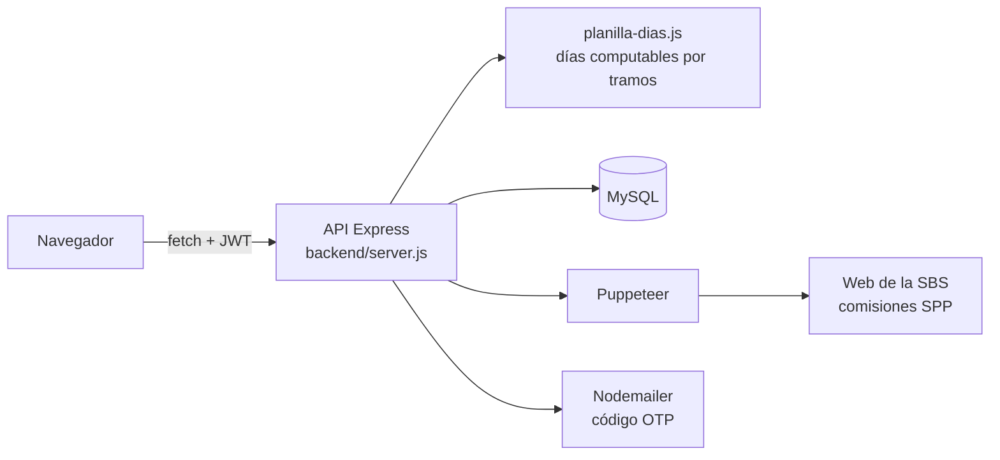

# Sistema de Planillas

Sistema web para calcular la **planilla mensual de remuneraciones de una municipalidad distrital** (sector público peruano). Reemplaza las hojas de cálculo que se armaban a mano cada mes: registra al personal, controla asistencias, aplica descuentos de ley y genera la boleta de pago y el reporte en Excel.

**[Ver demo](https://sistema-planillas.onrender.com)** · Usuario: `demo@planillas.com` · Contraseña: `demo1234`

> La demo corre en el plan gratuito de Render: la primera carga puede tardar cerca de un minuto. Todos los datos de la demo son ficticios.

<!-- Activar cuando exista docs/img/planilla.png:

-->

---

## Qué resuelve

Cada mes, el área de Recursos Humanos tiene que calcular el sueldo de cada trabajador según su régimen, sus días laborados, sus faltas y sus descuentos. Hacerlo en Excel es lento y propenso a errores: una fórmula mal copiada cambia el neto de decenas de personas.

Este sistema centraliza esa información y aplica las mismas reglas a todos, con historial de cambios y la planilla cerrada guardada como copia.

## Funcionalidades

**Personal**
- Registro de personas por DNI y de empleados con cargo, área, meta presupuestal, grupo ocupacional y régimen de pensiones.
- Tres regímenes: **Empleado**, **CAS** y **Obrero**.
- Bajas y reincorporaciones con **tramos laborales**: un trabajador puede cesar el 24 y reincorporarse el 25 del mismo mes, y se paga cada día una sola vez.
- Planilla separada para **reincorporados**.

**Cálculo de la planilla**
- Prorrateo automático por días computables (mes comercial de 30 días) según fecha de ingreso, cese o reincorporación.
- **Conceptos dinámicos**: ingresos, descuentos y aportes se configuran desde el sistema, con fecha de vigencia. Un concepto nuevo aparece como columna sin tocar código.
- Descuento por faltas y minutos de tardanza.
- **AFP** (aporte, comisión y prima de seguro) u **ONP**.
- Tasas de AFP actualizadas automáticamente desde la web de la **SBS** con Puppeteer.
- **Renta de 5ta categoría** con proyección anual y escala por tramos de UIT.
- **EsSalud** con base mínima según la RMV.
- Retenciones judiciales porcentuales, préstamos y cuotas sindicales.
- UIT y RMV configurables por periodo.

**Resultados**
- Tabla de planilla con totales, indicadores y gráfico.
- Boleta de pago por trabajador.
- Exportación a Excel con formato.

**Control**
- Login en dos pasos con código por correo y dispositivos de confianza.
- Roles de usuario: Administrador, Gestor RR. HH. y Asistente.
- **Auditoría** de cada cambio en fichas, conceptos, préstamos, judiciales y configuración, con el valor anterior y el nuevo.
- **Cierre de planilla**: guarda una copia versionada del periodo y bloquea las modificaciones hasta que se reabra.

<!-- Activar cuando existan las imágenes en docs/img/:
## Capturas

| Planilla | Boleta de pago |
|---|---|
|  |  |

| Ficha del trabajador | Conceptos |
|---|---|
|  |  |
-->

## Tecnologías

| Capa | Tecnología |
|---|---|
| Backend | Node.js, Express 5 |
| Base de datos | MySQL (Aiven, con SSL) |
| Autenticación | JWT, bcrypt, código OTP por correo con Nodemailer |
| Automatización | Puppeteer (tasas SPP de la SBS) |
| Frontend | HTML, JavaScript, Tailwind CSS, Tabulator, ApexCharts, SweetAlert2 |
| Excel | xlsx-js-style |
| Despliegue | Render |

## Arquitectura



```
SISTEMA_PLANILLAS/
├── backend/
│   ├── server.js            API: autenticación, personal, conceptos, asistencias, planilla, cierre
│   ├── planilla-dias.js     Cálculo de días computables por tramos laborales
│   └── migraciones/         Scripts de migración de la base de datos
├── frontend/                Páginas del sistema (planilla, mantenimientos, asistencias, usuarios)
└── package.json
```

<!-- Activar cuando exista docs/ANALISIS_SISTEMA.md:
El análisis técnico completo (flujo de la planilla, fórmulas y decisiones de diseño) está en [docs/ANALISIS_SISTEMA.md](docs/ANALISIS_SISTEMA.md).
-->

## Instalación local

**Requisitos:** Node.js 18 o superior y MySQL 8 (o MariaDB).

1. Clona el repositorio e instala las dependencias:
   ```bash
   git clone https://github.com/DRXD13/SISTEMA_PLANILLAS.git
   cd SISTEMA_PLANILLAS
   npm install
   ```

2. Crea la base de datos:
   ```bash
   mysql -u root -p -e "CREATE DATABASE planillas"
   ```
   <!-- Agregar cuando exista database/schema.sql:
   mysql -u root -p planillas < database/schema.sql
   -->

3. Ejecuta las migraciones en orden:
   ```bash
   node backend/migraciones/001_empleado_tramos.js
   node backend/migraciones/002_auditoria_fk_set_null.js
   node backend/migraciones/003_conceptos_dinamicos.js
   node backend/migraciones/004_conceptos_vigencia.js
   node backend/migraciones/005_planilla_snapshots.js
   ```

4. Crea el archivo `backend/.env`:
   ```env
   DB_HOST=localhost
   DB_PORT=3306
   DB_USER=root
   DB_PASSWORD=tu_contraseña
   DB_NAME=planillas
   JWT_SECRET=una_clave_larga_y_aleatoria
   EMAIL_USER=tu_correo@gmail.com
   EMAIL_PASS=tu_contraseña_de_aplicacion
   # true desactiva el código por correo (solo para la demo)
   DEMO_MODE=false
   ```

5. Inicia el servidor y abre `http://localhost:3000`:
   ```bash
   npm start
   ```

## Próximos pasos

- [ ] Mover el motor de cálculo al servidor como módulo independiente, para que el backend sea la única fuente de los montos.
- [ ] Tests automáticos del cálculo (días, AFP/ONP, renta de 5ta, EsSalud) y GitHub Actions.
- [ ] Guardar los montos calculados al cerrar la planilla.
- [ ] Validación de roles y de datos de entrada en el backend.
- [ ] Separar `server.js` en rutas, servicios y acceso a datos.
- [ ] Exportación PLAME y boletas en PDF.

## Autor

**Dangelo Retis Cabrera** · Estudiante de Ingeniería de Sistemas · Pisco, Perú

[Portafolio](https://portafolio-phi-roan-28.vercel.app) · [LinkedIn](https://www.linkedin.com/in/dangelo-retis-cabrera-a2b5a7370/) · [GitHub](https://github.com/DRXD13)
